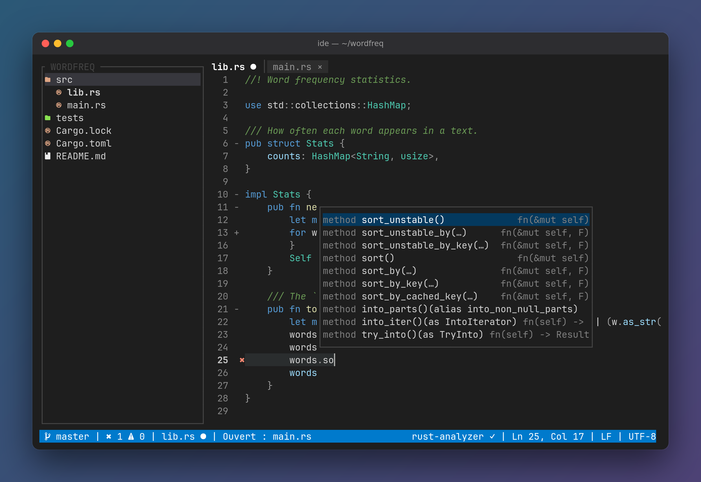

# IDE

*[English](README.md) · Français*

IDE de terminal en Rust, inspiré de VSCode : explorateur, éditeur, coloration tree-sitter et LSP, le tout dans votre terminal.



**État :** version 1.3 — les 21 exigences « Must » du cahier des charges, plus les langages web (HTML, CSS, PHP, JS/TS, Emmet), la mise en page, les paires automatiques et le repli des blocs, puis l'aide F1, les marques git, vingt thèmes, Go et le terminal intégré à onglets. Prochaines versions : exigences « Should » (multi-curseurs, écran divisé…).

## Prérequis

- Rust 1.88 ou plus récent (via [rustup](https://rustup.rs))
- Une [Nerd Font](https://www.nerdfonts.com) dans le terminal (recommandée, pour les icônes)

## Installation

```sh
cargo install --path crates/ide-app   # installe le binaire `ide` dans ~/.cargo/bin
ide ~/mon-projet
```

### Sous Windows (WSL)

1. Dans PowerShell **en administrateur** : `wsl --install`, puis redémarrer Windows.
2. Ouvrir **Ubuntu** depuis le menu Démarrer, créer l'utilisateur Linux, puis :

   ```sh
   sudo apt update && sudo apt install -y build-essential curl git
   curl --proto '=https' --tlsv1.2 -sSf https://sh.rustup.rs | sh
   source ~/.cargo/env
   cargo install --git https://github.com/blaspheme42/IDE ide-app --locked
   ```

3. Installer la Nerd Font **côté Windows** (double-clic sur les `.ttf`, *Installer*) et la choisir dans Windows Terminal : *Paramètres* → *Ubuntu* → *Apparence* → *Type de police*.
4. Les serveurs de langage s'installent dans Ubuntu (`sudo apt install clangd`, `sudo apt install nodejs npm` puis les `npm install -g` ci-dessous).

Garder ses projets dans le système de fichiers Linux (`~/projets`, pas `/mnt/c/...`) : bien plus rapide, et les changements de fichiers y sont détectés. Depuis Windows : `\\wsl$\Ubuntu\home\<utilisateur>`. Le copier-coller dans l'IDE marche toujours ; le partage du presse-papiers avec Windows demande WSLg (Windows 11, ou Windows 10 récent après `wsl --update`) ; coller depuis Windows par `Ctrl+Shift+V` ou clic droit marche partout.

Langages colorés : Rust, C, Python, JavaScript, TypeScript (et TSX), HTML (et Vue), CSS, JSON, TOML, Markdown, PHP, Go.

Serveurs de langage (facultatifs, démarrés automatiquement s'ils sont installés) :

| Langage | Serveur | Installation |
| --- | --- | --- |
| Rust | rust-analyzer | `rustup component add rust-analyzer` |
| C | clangd | paquet `clangd` |
| Python | pyright | `npm install -g pyright` |
| HTML (et `.vue`), CSS, JSON | vscode-*-language-server | `npm install -g vscode-langservers-extracted` |
| PHP | intelephense | `npm install -g intelephense` |
| Go | gopls | `go install golang.org/x/tools/gopls@latest` |
| JavaScript, TypeScript | typescript-language-server | `npm install -g typescript typescript-language-server` |
| Emmet (HTML, CSS, PHP) | emmet-language-server, en plus du serveur du langage | `npm install -g @olrtg/emmet-language-server` |

## Commandes

```sh
cargo run -p ide-app      # lance l'IDE (binaire `ide`)
cargo test --workspace    # lance tous les tests
```

## Configuration

`~/.config/ide/config.toml` (ou `$XDG_CONFIG_HOME/ide/config.toml`), surchargé par `<projet>/.ide/config.toml`. Toutes les clés sont facultatives ; une erreur s'affiche sans empêcher le démarrage.

```toml
[editor]
theme = "dark"          # dark | light | gruvbox | solarized-light | solarized-dark | nord | dracula | monokai | tokyo-night | catppuccin-latte | rose | automne | one-dark | catppuccin-mocha | rose-pine | everforest | kanagawa | ayu-mirage | gruvbox-light | github-light
line_numbers = true     # numéros de ligne dans la gouttière
word_wrap = false       # retour à la ligne visuel au bord de la fenêtre
tab_size = 4            # quand aucun .editorconfig ne s'applique
insert_spaces = true
format_on_save = true   # mise en page par le serveur de langage à chaque Ctrl+S
icons = "nerd"          # nerd | ascii

[explorer]
width = 30
show_hidden = false

[keys]                  # touche = nom de commande (voir la palette Ctrl+Shift+P)
"f5" = "save"
"ctrl+shift+k" = "close_tab"

[lsp.python]            # remplace le serveur par défaut d'un langage
command = "pylsp"
args = []
```

## Architecture

| Crate | Rôle | Dépend de |
| --- | --- | --- |
| `ide-app` | Binaire : arguments, boucle d'événements, raccourcis, presse-papiers | `ide-core`, `ide-ui`, `ide-workspace` (toutes à terme) |
| `ide-ui` | Widgets ratatui : explorateur, éditeur, onglets, popups, barre de statut | `ide-core` |
| `ide-core` | Buffers, curseurs, historique, sélection, commandes ; zéro I/O | — |
| `ide-syntax` | Coloration et requêtes tree-sitter, thèmes | `ide-core` |
| `ide-lsp` | Client LSP : lancement des serveurs, JSON-RPC sur stdio, conversion des positions | `ide-core` |
| `ide-workspace` | Arbre de fichiers, watcher, git, icônes, configuration, session | `ide-core` |

Le détail est dans le [cahier des charges](CAHIER_DES_CHARGES.md).

## Utilisation

- `F1` : tous les raccourcis, à l'écran (`Échap` ou `F1` ferme, flèches / `Page préc.` / `Page suiv.` / molette font défiler). La barre de statut le rappelle en permanence.
- `ide [dossier|fichier]` : sans argument, l'explorateur s'ouvre sur le dossier courant ; avec un dossier, sur ce dossier ; avec un fichier, l'ouvre (créé à la première sauvegarde s'il n'existe pas) avec pour racine le dossier courant s'il le contient, sinon le dossier du fichier.
- `Ctrl+S` : sauvegarder.
- Flèches, `Début`/`Fin`, `Page préc.`/`Page suiv.` : se déplacer ; `Ctrl+←`/`Ctrl+→` par mot, `Ctrl+Début`/`Ctrl+Fin` début/fin du fichier ; avec `Shift`, sélectionner. `Ctrl+A` : tout sélectionner. `Alt+Retour arrière` (ou `Ctrl+Retour arrière` si le terminal le distingue) : effacer le mot précédent.
- Souris : clic pour placer le curseur, glisser ou `Shift+clic` pour sélectionner, molette pour défiler, molette horizontale ou `Shift+molette` pour défiler de côté (selon le terminal). La sélection native du terminal reste possible avec `Shift`+glisser (selon le terminal).
- `Ctrl+Z` / `Ctrl+Y` (ou `Ctrl+Shift+Z`) : annuler / rétablir, sans limite.
- `Alt+:` (ou `Ctrl+:` sous protocole Kitty) : commenter / décommenter les lignes, selon le langage du fichier.
- `Ctrl+C` / `Ctrl+X` / `Ctrl+V` : copier / couper / coller (sans sélection : la ligne entière). Presse-papiers système, ou interne si aucun n'est disponible (SSH).
- Emmet (HTML, CSS, PHP, si emmet-language-server est installé) : tapez une abréviation (`ul>li*3`, `div.carte`, `m10` en CSS), elle apparaît dans la liste de complétion, `Entrée` la développe. Sans lui, `!` puis `Tab` insère quand même une page HTML5, `!!!` puis `Tab` le doctype.
- `Tab` / `Shift+Tab` : indenter / désindenter (la sélection entière si elle couvre plusieurs lignes) ; `Entrée` garde l'indentation. Tabulations ou espaces et largeur selon `.editorconfig` (4 espaces par défaut).
- Paires automatiques : `(`, `[`, `{`, `"` et `'` insèrent leur fermante derrière le curseur ; taper la fermante déjà présente la saute, `Retour arrière` entre une paire vide retire les deux. Pas de fermante devant un mot, ni pour un guillemet collé à un mot (`l'arbre`), ni pour `'` en Rust. La parenthèse, le crochet ou l'accolade associé au curseur est mis en surbrillance.
- Repli des blocs (selon l'indentation) : `Alt+-` replie le bloc du curseur, `Alt+=` le déplie, `Alt+_` / `Alt++` replient / déplient tout ; clic dans la gouttière pour basculer une ligne. La gouttière marque d'un `-` les blocs repliables et d'un `+` les blocs repliés (suivis de `⋯`), les flèches le sautent, il se déplie si le curseur y arrive (recherche, F12, annuler).
- Marques git (comme VS Code) : une barre colorée en début de gouttière signale les lignes ajoutées (vert), modifiées (bleu) ou supprimées (`▁` / `▔` rouge) depuis le dernier commit, à jour pendant la frappe. Fichier non suivi, hors dépôt git (ou sans git) : aucune marque.
- Affichage : `Alt+L` affiche / masque les numéros de ligne, `Alt+Z` active / coupe le retour à la ligne visuel (coupure aux espaces, haut / bas par rangée visuelle, `Début` / `Fin` vont au bord de la rangée puis de la ligne ; `toggle_word_wrap` dans `[keys]`), `Alt+T` passe au thème suivant (`dark`, `light`, `gruvbox`, `solarized-light`, `solarized-dark`, `nord`, `dracula`, `monokai`, `tokyo-night`, `catppuccin-latte`, `rose`, `automne`, `one-dark`, `catppuccin-mocha`, `rose-pine`, `everforest`, `kanagawa`, `ayu-mirage`, `gruvbox-light`, `github-light`), aussi depuis la palette de commandes. Le dernier thème choisi est gardé pour le prochain lancement et passe avant `theme` dans la configuration.
- HTML et PHP : taper le `>` d'une balise ouvrante insère sa fermante (`<div>|</div>`), sauf éléments vides (`<br>`, ``…) et `/>`.
- `Ctrl+F` / `Ctrl+H` : rechercher / remplacer. Dans la barre : `Entrée` ou `F3` suivant, `Shift+F3` précédent, `Tab` change de champ, `Entrée` dans « Remplacer » remplace l'occurrence courante, `Alt+Entrée` remplace tout, `Alt+R` regex (`$1`, `${nom}` dans le remplacement), `Alt+C` casse, `Échap` ferme.
- Explorateur : `Ctrl+B` l'affiche ou le masque, `Ctrl+E` y place le focus ; flèches pour naviguer, `Entrée` ouvre, `n` / `Shift+N` nouveau fichier / dossier, `F2` ou `r` renommer, `m` déplacer, `Suppr` corbeille (confirmation), `.` fichiers cachés, `<` / `>` largeur.
- Onglets : `Ctrl+W` ou clic sur `×` / `●` fermer (deux fois si modifié), `Ctrl+PageSuiv` / `Ctrl+PagePréc` suivant / précédent, `Alt+1`…`Alt+9`.
- Palettes : `Ctrl+P` ouvrir un fichier du projet (recherche floue), `Ctrl+Shift+P` (ou `Ctrl+P` puis `>`) toutes les commandes.
- Recherche dans le projet : `Ctrl+Shift+F` (kitty, WezTerm, foot, Ghostty, Alacritty) ou `Alt+F` (partout), aussi dans la palette et `project_search` dans `[keys]`. Résultats à la frappe, `Alt+R` regex, `Alt+C` casse, `Entrée` ouvre le résultat ; à la réouverture, requête et résultats reviennent. La recherche lit le disque : les modifications non sauvegardées n'y sont pas vues. Fichiers non UTF-8 ou de plus de 5 Mio sautés, liens symboliques et fichiers cachés (sauf s'ils sont affichés) exclus, seuls les 100 premiers Kio d'une ligne cherchés, 1000 résultats au plus.
- Code (serveur de langage démarré automatiquement, voir Installation) : complétion à la frappe ou `Ctrl+Espace` (`Entrée`/`Tab` accepte), `Ctrl+K` infobulle, `F12` aller à la définition, `Alt+Shift+F` mettre en page (aussi `Ctrl+0` dans kitty, WezTerm, foot, Ghostty, Alacritty), `F8` / `Shift+F8` problème suivant / précédent, `Ctrl+Shift+M` panneau Problèmes. Un serveur absent ou planté n'empêche jamais d'éditer.
- Terminal intégré (panneau bas, shells en onglets lancés dans le dossier du projet) : `Ctrl+ù` (kitty, WezTerm, foot, Ghostty, Alacritty) ou `Alt+J` (partout), aussi « Terminal : ouvrir / aller / fermer » dans la palette et `toggle_terminal` dans `[keys]`. Fermé, il s'ouvre et prend le focus ; ouvert sans focus, il prend le focus ; ouvert avec focus, il se ferme et rend le focus à l'éditeur. Avec le focus, tout va au shell sauf la bascule et les touches d'onglets : `Ctrl+Q`, `Ctrl+P` et `F1` n'agissent pas sur l'IDE. `Alt+T` ouvre un onglet, `Alt+Page suiv.` / `Alt+Page préc.` passent au suivant / précédent, en boucle ; clic sur un numéro de la bordure haute pour activer son onglet. Fermer le panneau garde les shells ; `exit` ferme son onglet, même en arrière-plan, et le panneau se ferme avec le dernier : un nouveau shell démarre alors à la prochaine ouverture. Clic dans le panneau pour le focus, molette pour l'historique.
- Fichier modifié par un autre programme : rechargé automatiquement s'il n'a pas de modifications, sinon `Alt+R` recharge, `Alt+K` garde votre version.
- `Ctrl+Q` : quitter ; s'il y a des modifications non sauvegardées, `Ctrl+Q` deux fois pour quitter sans sauvegarder.
- Logs : `$XDG_STATE_HOME/ide/ide.log` (par défaut `~/.local/state/ide/ide.log`).
- `ide --panic-test` : panique volontairement après le premier rendu, pour vérifier que le terminal est bien restauré.

## Licence

MIT, voir [LICENSE](LICENSE).
