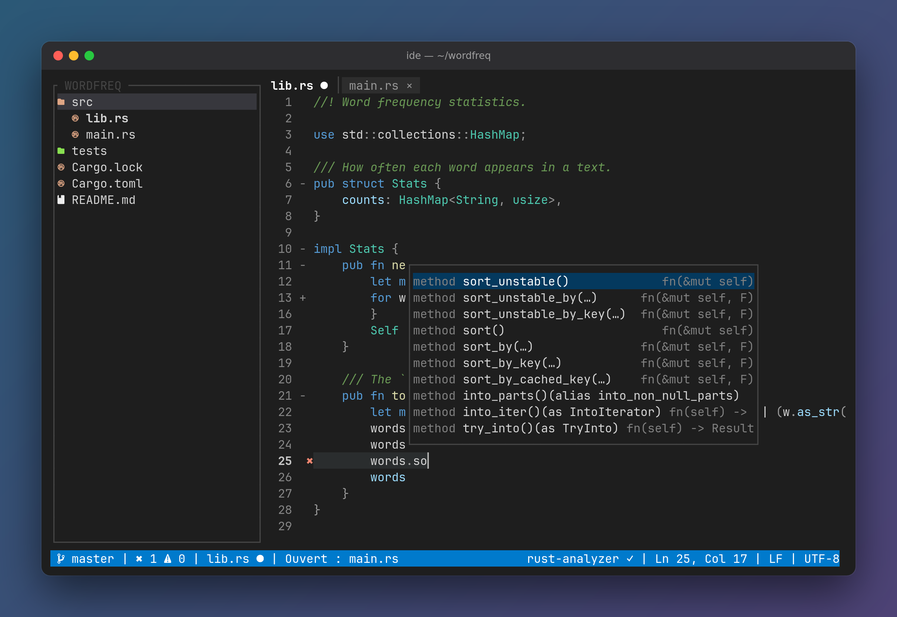

# IDE

*English · [Français](README.fr.md)*

[](https://github.com/blaspheme42/IDE/actions/workflows/ci.yml)


**A VS Code–style IDE that runs in your terminal, written in Rust.** File explorer, tabs, tree-sitter syntax highlighting, and language-server completion, go-to-definition and diagnostics. One binary, usable locally or over SSH.



> **Status: 1.1, usable for daily editing.** Tested on Linux. macOS is built by CI but not tested by hand. On Windows, use WSL. The interface (status messages, menus, prompts) is currently in French.

## Features

- **Explorer**: file tree with icons, respects `.gitignore`. Create, rename, move, or delete (to the trash). Refreshes when files change on disk.
- **Editor**: unlimited undo/redo, mouse selection, system clipboard (internal fallback over SSH). Keeps LF/CRLF line endings. Indentation from `.editorconfig`.
- **Editing helpers**: auto-closing `()` `[]` `{}` `""` `''`, bracket matching, HTML tag auto-closing, Emmet, and indentation-based code folding.
- **Search**: find and replace in the current file, with regex and capture groups.
- **Language servers**: completion, hover, go-to-definition, diagnostics, and formatting (also on save). Servers start automatically when installed. A missing or crashed server never blocks editing.
- **Syntax highlighting** (tree-sitter): Rust, C, Python, JavaScript, TypeScript (and TSX), HTML (and Vue), CSS, JSON, TOML, Markdown, PHP, Go.
- **Tabs, fuzzy file picker, command palette**, dark and light themes, configurable key bindings.
- **Safety**: backup copies of unsaved work, restored after a crash. Session (open tabs, cursor positions) restored on restart.

## Installation

### 1. Install Rust

You need Rust 1.88 or newer. If you don't have it:

```sh
curl --proto '=https' --tlsv1.2 -sSf https://sh.rustup.rs | sh
```

Then open a new terminal (or run `source ~/.cargo/env`). Check with `cargo --version`.

You also need a C compiler, used to build the tree-sitter grammars:

```sh
sudo apt install build-essential   # Debian / Ubuntu
sudo dnf install gcc               # Fedora
xcode-select --install             # macOS
```

### 2. Install IDE

```sh
cargo install --git https://github.com/blaspheme42/IDE ide-app --locked
```

This builds the `ide` binary and puts it in `~/.cargo/bin`, which rustup adds to your `PATH`. The first build takes a few minutes.

### 3. Install a Nerd Font (recommended)

File icons use a [Nerd Font](https://www.nerdfonts.com/font-downloads). Install one (for example *JetBrainsMono Nerd Font*) and select it in your terminal settings. Without one, set `icons = "ascii"` in the [configuration](#configuration).

### 4. Install language servers (optional)

IDE starts the server for the file you open if it finds it on your `PATH`:

| Language | Server | Install |
| --- | --- | --- |
| Rust | rust-analyzer | `rustup component add rust-analyzer` |
| C | clangd | `sudo apt install clangd` |
| Python | pyright | `npm install -g pyright` |
| HTML (and `.vue`), CSS, JSON | vscode-langservers-extracted | `npm install -g vscode-langservers-extracted` |
| JavaScript, TypeScript | typescript-language-server | `npm install -g typescript typescript-language-server` |
| PHP | intelephense | `npm install -g intelephense` |
| Go | gopls | `go install golang.org/x/tools/gopls@latest` |
| Emmet (HTML, CSS, PHP) | emmet-language-server | `npm install -g @olrtg/emmet-language-server` |

### 5. Run it

```sh
ide                  # open the current folder
ide ~/my-project     # open a folder
ide src/main.rs      # open a file (created on first save if it doesn't exist)
```

### Update and uninstall

```sh
cargo install --git https://github.com/blaspheme42/IDE ide-app --locked --force   # update
cargo uninstall ide-app                                                            # uninstall
```

### From a local clone

```sh
git clone https://github.com/blaspheme42/IDE
cd IDE
cargo install --path crates/ide-app --locked
```

## Key bindings

| Keys | Action |
| --- | --- |
| `Ctrl+S` / `Ctrl+Q` | Save / quit (press `Ctrl+Q` twice to discard unsaved changes) |
| `Ctrl+P` / `Ctrl+Shift+P` | Open a project file / command palette |
| `Ctrl+Z` / `Ctrl+Y` | Undo / redo |
| `Ctrl+C` / `Ctrl+X` / `Ctrl+V` | Copy / cut / paste (no selection: the whole line) |
| `Ctrl+A` | Select all |
| `Ctrl+←` / `Ctrl+→`, `Ctrl+Home` / `Ctrl+End` | Move by word, to start / end of file (add `Shift` to select) |
| `Alt+Backspace` | Delete previous word |
| `Tab` / `Shift+Tab` | Indent / unindent; `Tab` also expands Emmet `!` and `!!!` |
| `Ctrl+F` / `Ctrl+H` | Find / replace (`F3` next, `Alt+Enter` replace all, `Alt+R` regex, `Alt+C` match case) |
| `Alt+-` / `Alt+=` | Fold / unfold the block at the cursor (or click `-` / `+` in the gutter) |
| `Alt+_` / `Alt++` | Fold / unfold everything |
| `Ctrl+Space` | Completion (also appears as you type) |
| `Ctrl+K` / `F12` | Hover info / go to definition |
| `Alt+Shift+F` | Format the file (also `Ctrl+0` in kitty, WezTerm, foot, Ghostty, Alacritty) |
| `F8` / `Shift+F8`, `Ctrl+Shift+M` | Next / previous problem, problems panel |
| `Ctrl+W`, `Ctrl+PageDown` / `Ctrl+PageUp`, `Alt+1`…`Alt+9` | Close tab, next / previous tab, go to tab |
| `Ctrl+B` / `Ctrl+E` | Show / hide explorer, focus explorer |

In the explorer: arrows to move, `Enter` to open, `n` / `Shift+N` new file / folder, `F2` or `r` rename, `m` move, `Delete` trash, `.` show hidden files, `<` / `>` resize.

When a file changes on disk, IDE reloads it if you have no unsaved changes. Otherwise, `Alt+R` reloads it and `Alt+K` keeps your version.

## Configuration

`~/.config/ide/config.toml` (or `$XDG_CONFIG_HOME/ide/config.toml`), overridden per project by `<project>/.ide/config.toml`. Every key is optional. An invalid file shows an error but never prevents startup.

```toml
[editor]
theme = "dark"          # dark | light
tab_size = 4            # when no .editorconfig applies
insert_spaces = true
format_on_save = true   # format with the language server on Ctrl+S
icons = "nerd"          # nerd | ascii

[explorer]
width = 30
show_hidden = false

[keys]                  # key = command name (see the palette, Ctrl+Shift+P)
"f5" = "save"
"ctrl+shift+k" = "close_tab"

[lsp.python]            # replace a language's default server
command = "pylsp"
args = []
```

Logs go to `$XDG_STATE_HOME/ide/ide.log` (default `~/.local/state/ide/ide.log`).

## Development

```sh
cargo run -p ide-app      # run from source
cargo test --workspace    # run all tests
```

| Crate | Role |
| --- | --- |
| `ide-app` | Binary: arguments, event loop, clipboard, background jobs |
| `ide-core` | Documents, cursors, history, editor state and commands. No I/O |
| `ide-ui` | ratatui rendering: explorer, editor, tabs, popups, status bar |
| `ide-syntax` | tree-sitter highlighting |
| `ide-lsp` | Language server client: JSON-RPC over stdio |
| `ide-workspace` | File tree, watcher, git, configuration |

The full specification (in French) is in [CAHIER_DES_CHARGES.md](CAHIER_DES_CHARGES.md), and the changes in [CHANGELOG.md](CHANGELOG.md).

## Roadmap

Multi-cursor editing, split view, rename symbol, find references, project-wide search, integrated terminal, git status colors.

## License

MIT, see [LICENSE](LICENSE).
